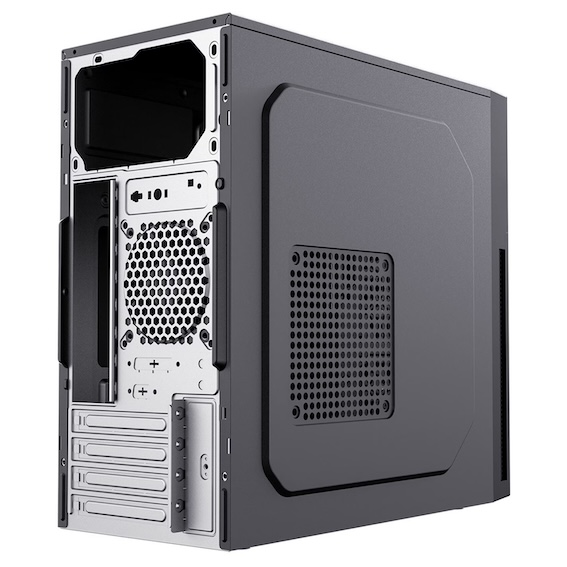
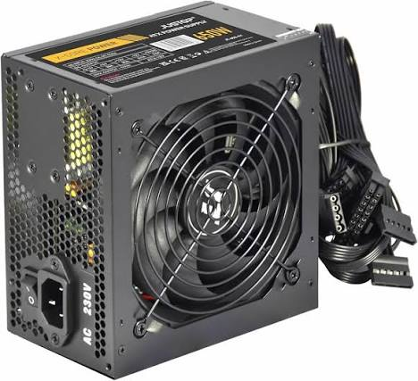
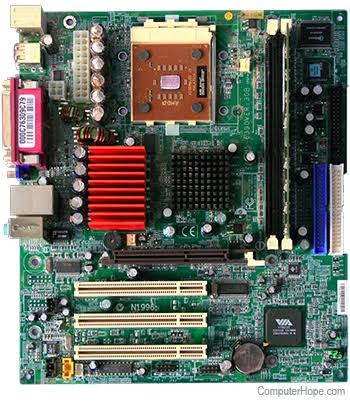
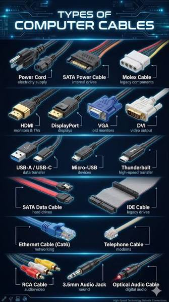
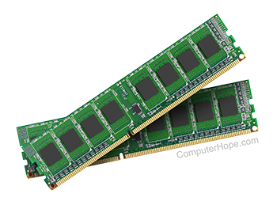
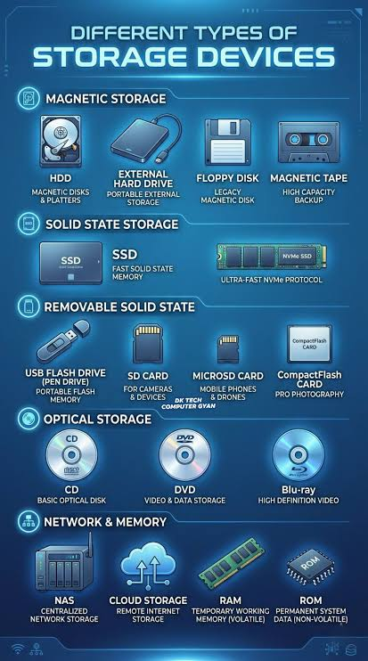
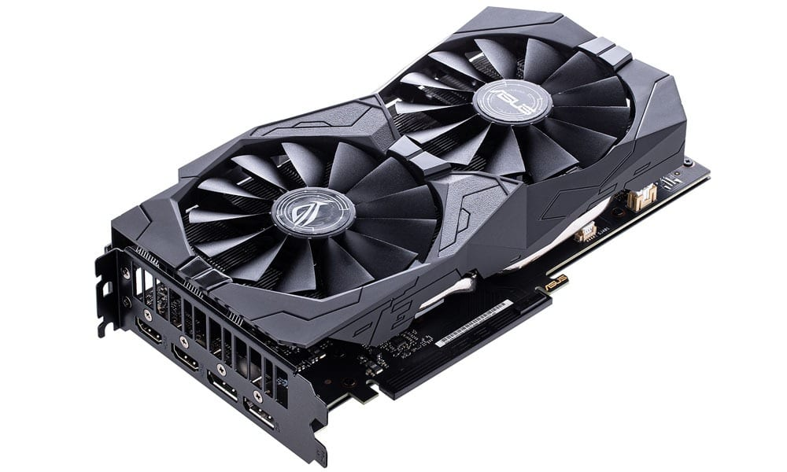

# Part 2 – Computer Disassembly
## Before Openingthe Computer
Describe the computer before opening it.
Open the case, Unplug internal cables, Remove storage devices, Take out the 
GPU, Extract the RAM, Unmount the power supply, Remove the motherbaord.

Insert image:
```







```
---
## Internal Layout
Open the computer case and observe the internal components.
Describe what you see.

Inside the desktop cover you can see the: Motherbaord, Screws,
Cables from the power supply, RAM Slots, Storage devices, Peripheral Device, 
CPU, GPU, Cooling fan, I/O Device.

Insert image:
```


```